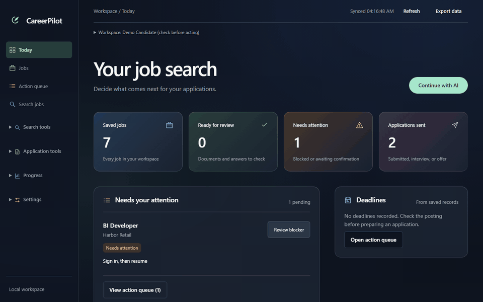
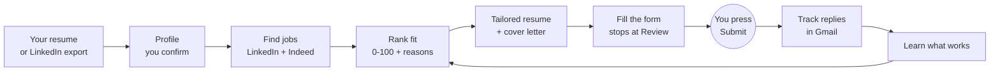
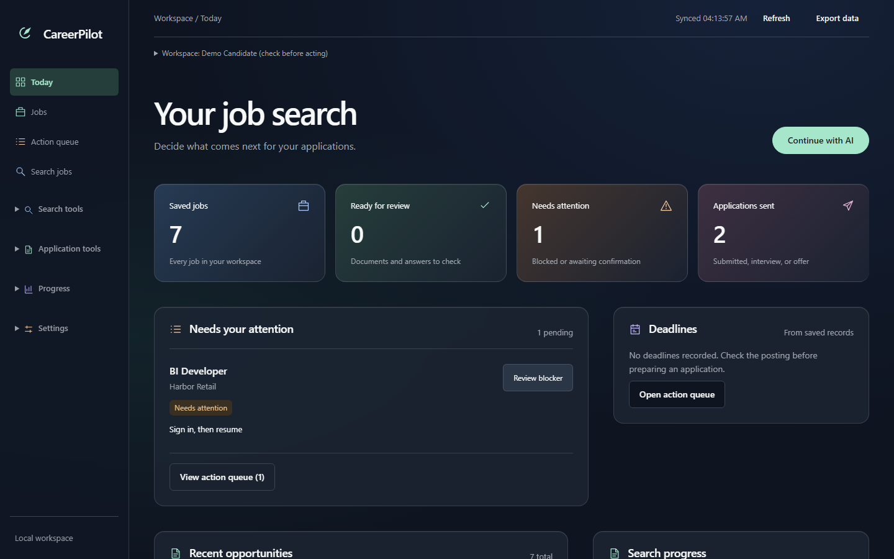

<h1 align="center">CareerPilot</h1>

<p align="center"><strong>The AI job-search co-pilot that lives inside your AI agent.</strong></p>

<p align="center">
  
  
  
  
  
  
</p>

<p align="center">
<strong>Job hunting is a second full-time job.</strong><br>
So I built a co-pilot to do the repetitive parts with&nbsp;me.
</p>

<p align="center">
<strong>Every job ranked. Every resume tailored. Every reply tracked.</strong><br>
I built it for my own search and use it&nbsp;daily.
</p>

<p align="center">
It finds jobs, tells you how well you fit, and writes a resume for each&nbsp;one.<br>
It fills in the form and stops at the last step. <strong>You&nbsp;press&nbsp;Submit.</strong>
</p>

<p align="center">
  
</p>

<p align="center"><sub>The local dashboard, shown with demo data.</sub></p>

<p align="center"><a href="#your-turn">Try it in 2 minutes&nbsp;↓</a> · <a href="#what-careerpilot-does-for-you">See what it does&nbsp;↓</a></p>

<p align="center">⭐ <strong>If CareerPilot helps you, a star helps the next job seeker find&nbsp;it.</strong></p>

<br>

## Your turn

You need [Python 3.10+](https://www.python.org/downloads/) and [Claude Code](https://code.claude.com/docs/en/skills) or [Codex](https://learn.chatgpt.com/docs/build-skills).

```bash
git clone https://github.com/SanketParab3004/CareerPilot.git
cd CareerPilot
python tools/install_skill.py --host claude --user    # or: --host codex --user
```

Then open your agent and type **`/careerpilot`** (Claude Code) or **`$careerpilot`** (Codex).

<p align="center"><sub>Free and open source. No account, no API key, no server. Your data stays on your computer.</sub></p>

## What CareerPilot does for you

- **Where do I even start?** Give it your resume or LinkedIn export. It builds your profile and shows it to you before saving anything.
- **Which jobs are worth it?** It searches LinkedIn and Indeed, skips Easy Apply, removes duplicates and reposts, and ranks each job against your real experience.
- **Will my resume pass?** It writes a resume and cover letter for each job using only facts from your profile, then reads the final file back to check it.
- **So many forms.** It fills the employer's application in your browser and stops at Review.
- **Did anyone reply?** It reads job emails in Gmail (read-only) and updates each application: received, interview, rejected or offer.
- **What's working?** It shows which roles, sources and resume versions get replies, which skills your target jobs ask for, and what they pay.
- **Who do I know there?** It matches your LinkedIn connections to the companies you're applying to.
- **The interview is tomorrow.** It builds a story bank from your real experience and runs practice rounds.

On first run it doesn't know you yet. Talk to it: your resume, the roles you want, what you won't accept. It saves your answers and gets better with every application.

## What CareerPilot will not do

- **Submit without you.** Every submit needs your approval for that job or for a batch you approve explicitly. Uncertain submits are never retried automatically.
- **Make things up.** Every resume claim has to trace back to a fact in your profile, and the final file is checked before you see it.
- **Send messages for you.** Outreach and referral messages are drafts until you approve each one.
- **Solve CAPTCHAs or log in for you.** It pauses that job, sends you an alert if you set one up, and moves on to the next.
- **Send your data anywhere.** There's no server and no tracking. Your files stay in a private folder on your computer.

## Features

| Feature | What it does |
|---|---|
| **Profile import** | Resume (PDF, Word, text), LinkedIn and Indeed exports. Shows conflicting facts and waits for your OK before saving. |
| **Job discovery** | LinkedIn and Indeed searches limited to jobs that apply on the employer's own site. Duplicates, reposts and likely scams are flagged. |
| **Fit ranking** | A 0–100 score with strengths, gaps and unknowns for each job, plus an honest reason. |
| **Tailored documents** | A resume and cover letter for each job from your own facts, with a fact check and a review of the final file. Never cut down to fit one page unless you ask. |
| **Application filling** | Fills forms on Workday, Greenhouse, Lever, iCIMS and others, remembers your approved answers, and stops at Review. |
| **Gmail tracking** | Read-only matching of employer emails to your applications, with the evidence saved for each status change. |

<details>
<summary><b>Everything else it does</b></summary>

| Feature | What it does |
|---|---|
| **Login queue** | Groups jobs that need a sign-in by site, so you can clear them in one sitting. |
| **Learning from results** | Response, interview and offer rates by role, source, resume version and timing. Ranking changes need 20+ applications and your approval. |
| **Draft-edit feedback** | Remembers what you changed in its drafts and why, and follows that next time. |
| **Market view** | How often your skills appear in your target jobs, which common skills you don't list, and published pay by role. |
| **Referral paths** | Matches your LinkedIn connections, schools and past employers to companies, and drafts messages for you to approve. |
| **Daily top 5** | Picks the best new jobs each day, with optional Telegram alerts. |
| **Site playbooks** | Known fixes for common application systems, plus a log of what failed and why. |
| **Interview prep** | Story bank, prep packs, practice rounds with feedback, and offer comparison. |
| **Phone alerts** | Telegram messages when a job needs you (login, CAPTCHA, a question only you can answer). |
| **Encrypted passwords** | Site passwords are encrypted with Windows DPAPI, macOS Keychain or Linux Secret Service. |
| **Backup and restore** | One-command backup, optional encryption, restore, and secure delete. |
| **Local dashboard** | Your whole search in the browser: jobs, action queue, documents, results. |

</details>

## How it works



Your AI agent does the thinking, the browsing and the writing. CareerPilot gives it a step-by-step playbook for each stage and a small Python helper that keeps a reliable record of every job, document, approval and reply, so nothing is lost between sessions.

## Quick start

**1. Get the code**

```bash
git clone https://github.com/SanketParab3004/CareerPilot.git
cd CareerPilot
```

No Git? Click **Code → Download ZIP** on GitHub and unzip it.

**2. Install the skill**

```bash
python tools/install_skill.py --host claude --user   # Claude Code
python tools/install_skill.py --host codex --user    # Codex
```

`--user` makes it available in all your projects. Use `--project "PATH"` for one folder, or `--dry-run` to see where it would go.

**3. Start**

Type `/careerpilot` (Claude Code) or `$careerpilot` (Codex). It creates a private `job-search-workspace` folder, confirms the location with you, and walks you through setup by chatting. You don't need to edit any files by hand.

<details>
<summary><b>Optional extras</b></summary>

- **Filling applications** needs a browser tool connected to your agent, such as Claude in Chrome.
- **Reply tracking** needs Gmail connected to your agent.
- **Phone alerts** need a Telegram bot. Setup is in the dashboard under Accounts & alerts.
- **PDF resume import** needs `pip install pypdf`.

</details>

<details>
<summary><b>Try it with fake data first</b></summary>

```bash
python skills/careerpilot/scripts/toolkit.py --workspace demo-workspace demo
python skills/careerpilot/scripts/toolkit.py --workspace demo-workspace dashboard --open
```

</details>

## Usage

Just ask in plain English. These cover most days:

| Ask | What happens |
|---|---|
| *"Set up my profile from my resume"* | Imports it, shows conflicts, saves only after you confirm |
| *"Find Data Analyst jobs in Toronto from this week"* | Searches, removes duplicates, ranks every job |
| *"Prepare applications for the top 3"* | Tailored resume and cover letter for each, checked and ready for your review |
| *"Fill them in and stop at Review"* | Fills each form in your browser and pauses anything that needs you |
| *"Check Gmail for replies"* | Matches employer emails to your applications and updates their status |
| *"Show my progress this week"* | Weekly review: applications sent, replies, what's stuck, what to do next |

<details>
<summary><b>Everything you can ask, by stage of the search</b></summary>

**Set up**

| Ask | Guide |
|---|---|
| Set up or update my profile | [Profile and documents](skills/careerpilot/references/profile-and-documents.md) |
| Import my resume, LinkedIn or Indeed export | [Profile import](skills/careerpilot/references/profile-import.md) |
| Save account details, set up phone alerts | [Accounts and alerts](skills/careerpilot/references/accounts-and-assistance.md) |

**Find jobs**

| Ask | Guide |
|---|---|
| Find jobs and rank how well I fit | [Discovery and ranking](skills/careerpilot/references/discovery.md) |
| Run my daily top 5 | [Daily workflow](skills/careerpilot/references/daily.md) |
| Who do I know at these companies? | [Referrals](skills/careerpilot/references/networking.md) |
| Find the hiring team and draft a message | [Recruiting contacts](skills/careerpilot/references/contacts.md) |

**Apply**

| Ask | Guide |
|---|---|
| Tailor my resume for this job | [Resume tailoring](skills/careerpilot/references/resume-tailoring.md) and [document checks](skills/careerpilot/references/document-quality.md) |
| Fill the applications, resume my queue | [Applications](skills/careerpilot/references/application-quality.md) |
| Clear my blockers, start a login sitting | [Backlog and recovery](skills/careerpilot/references/backlog.md) |

**After you apply**

| Ask | Guide |
|---|---|
| Check Gmail and update my applications | [Gmail tracking](skills/careerpilot/references/email-review.md) |
| What's working? What skills and pay do my jobs show? | [Results and learning](skills/careerpilot/references/learning.md) |
| Prepare me for an interview, compare offers | [Interviews and offers](skills/careerpilot/references/interviews.md) |
| Open my dashboard | [Dashboard](skills/careerpilot/references/dashboard.md) |

</details>

## Dashboard

Ask your agent to *"open my CareerPilot dashboard"*, or double-click **`Open Dashboard.cmd`** on Windows. It runs only on your computer and never submits applications or sends email.



## Project structure

```text
CareerPilot/
├── skills/careerpilot/       # The installable skill
│   ├── SKILL.md              # The playbook your agent reads first
│   ├── references/           # One guide per stage of the search
│   ├── scripts/              # Python helper (standard library only)
│   └── assets/dashboard/     # Local dashboard
├── tools/                    # Installer and packager
├── tests/                    # 176 automated tests (fake data only)
├── docs/                     # Screenshots
└── legacy/dashboard/         # Old prototype, not used by the skill

job-search-workspace/         # Your private data, created on first run, never committed
```

## Tech stack

- **Agent:** Claude Code or Codex, through the open Agent Skills format
- **Helper:** Python 3.10+, standard library only, with a SQLite database
- **Dashboard:** plain HTML, CSS and JavaScript served locally
- **Optional:** `pypdf` for PDF import, Playwright for password autofill, Telegram for alerts

## FAQ

**What is CareerPilot?**
An open-source skill for AI coding agents that runs your job search from start to finish: profile, discovery, ranking, tailored resumes, form filling and reply tracking. You make every decision.

**Is it free?**
Yes, MIT licensed. You only need your own AI agent subscription.

**Does it apply to jobs automatically?**
No. It prepares and fills applications, and you press Submit. You can approve a batch in advance if you want, but nothing goes out without your approval.

**Can the tailored resume invent experience?**
It must not. Every claim has to trace back to your confirmed profile, and the final file is checked before you review it. Still, read every resume before you send it.

**Does it work with ChatGPT or Gemini in the browser?**
No. It needs an agent that can run files, Python and a browser, such as Claude Code or Codex.

**Does it work on Mac and Linux?**
The core works anywhere Python 3.10+ runs. Most testing so far has been on Windows.

**Which countries?**
Any. Location, currency and work-permit questions are configurable. It was built during a search in Canada.

**Something isn't working.**
Run `python skills/careerpilot/scripts/toolkit.py --workspace YOUR-FOLDER doctor` for plain-English fixes, or [open an issue](https://github.com/SanketParab3004/CareerPilot/issues).

## Disclaimer

CareerPilot is a local, open-source tool, not a hosted service.

1. **Your data stays with you.** Your profile and documents stay on your computer and go only to the AI provider you choose.
2. **Review everything.** AI can make mistakes. Check every resume, answer and message before it goes out.
3. **Follow each site's rules.** Use it within the terms of the job sites you visit, and don't use it to spam employers.
4. **No guarantees.** Rankings and suggestions are guidance, not promises of interviews or offers.

## Contributing

Issues and pull requests are welcome. Run the tests first:

```bash
python -m unittest discover -s tests -v
python tools/package_skill.py    # builds dist/careerpilot.zip
```

Got an interview or an offer with CareerPilot? [Share your story](https://github.com/SanketParab3004/CareerPilot/issues/new). It helps the next person decide to try it.

## License

[MIT](LICENSE). Free to use, change and share.

<p align="center"><sub>Built by <a href="https://github.com/SanketParab3004">@SanketParab3004</a> while job hunting.</sub></p>
